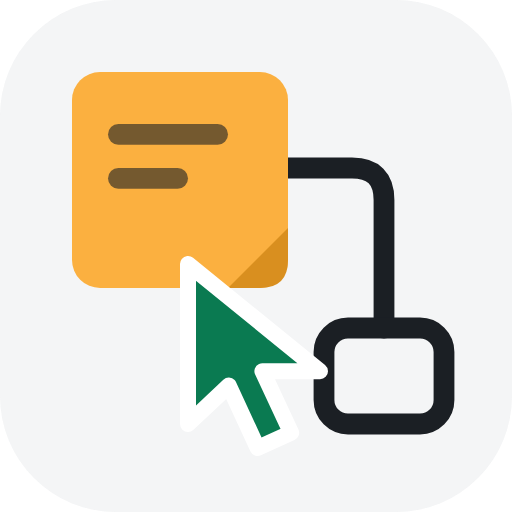
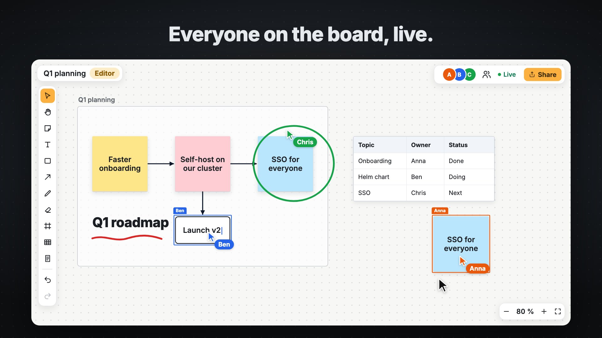
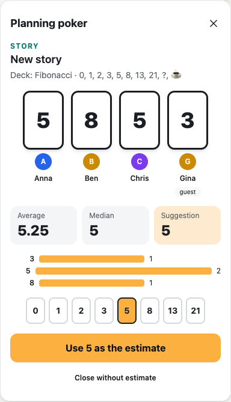

<div align="center">



# Drawboard

**A collaborative whiteboard you run yourself.**<br>
An open alternative to Miro, for teams that want their boards on their own servers.

[](https://drawboard.dergeorg.at)
&nbsp;
[](https://drawboard.dergeorg.at/install)
&nbsp;
[](https://github.com/DerGeorg?tab=packages)
&nbsp;
[](LICENSE)

Live collaboration · Any OIDC sign-in · Hardened defaults · No licence keys

</div>

> Development happens in a private GitLab with four repositories; this repository is a
> **snapshot** of their `main` branches, refreshed every night. Problems, questions and ideas
> belong in the [GitHub issues](https://github.com/DerGeorg/drawboard/issues). Security problems
> go through [a private report](https://github.com/DerGeorg/drawboard/security/advisories/new),
> never a public issue.

---

Whiteboards have become the place where teams plan, sketch and decide, and almost all of them
live on somebody else's servers. Every sticky note, every roadmap, every half-finished idea ends up
in a SaaS account with per-seat pricing and a data processing agreement.

Drawboard is a whiteboard you install next to your other services. Sign-in goes through the
identity provider you already have, the boards live in your PostgreSQL, and everyone edits the same
board at the same time, with cursors, selections and follow mode, as you would expect from the
hosted tools.

<div align="center">

<a href="https://drawboard.dergeorg.at/#trailer"></a><br>
<sub>▶ The one-minute trailer</sub>

</div>

## Try it

On your own machine in five minutes, with a bundled Keycloak and three test users:

```sh
git clone https://github.com/DerGeorg/drawboard.git
cd drawboard/deploy/compose
./generate-keys.sh
docker compose -f docker-compose.yml -f compose.trial.yaml --env-file trial/trial.env up -d
```

Open <http://localhost:8080> and sign in as `anna` / `anna`. A second browser as `ben` / `ben`
shows the live collaboration. Details and how to stop it: [`deploy/compose/README.md`](deploy/compose/README.md).

## Install

**Kubernetes with Helm:**

```sh
helm install drawboard oci://ghcr.io/dergeorg/charts/drawboard --version <version> \
  -n drawboard --create-namespace -f my-values.yaml
```

What the values need (OIDC, keys, database, ingress, trusted proxies):
[the chart README](deploy/helm/drawboard/README.md).

**One server with Docker Compose**, behind your reverse proxy: the same folder as the trial,
[`deploy/compose/`](deploy/compose/README.md).

A step-by-step guide for both, including the identity provider setup, is at
**[drawboard.dergeorg.at/install](https://drawboard.dergeorg.at/install)**.

## What you get

|  |  |
|---|---|
| 🧩 **Everything a board needs** | Sticky notes, text, shapes, connectors, pen, frames and tables; copy and paste; undo; zoom out to 2 % on large boards |
| 👥 **Live together** | Everyone edits at the same time, sees the others' cursors and selections, follows another participant or brings everyone to their own view |
| 🃏 **Planning built in** | Kanban boards with story cards, and planning poker with or without a story card |
| 📄 **Diagrams and files** | Mermaid blocks, images, PDFs and Office documents right on the board |
| 🗂️ **Organised** | Folders, sharing with people and groups, export and import |
| 🔗 **Guest links** | Share a board with people without an account, to view, comment or edit (off until you switch it on) |
| 🔌 **Plugins** | Your own block types and tools, also from third parties, in a sandboxed iframe |
| 🔑 **Your sign-in** | Any OpenID Connect provider: Keycloak, Authelia, Authentik, Zitadel, Entra ID … |
| 🔒 **Hardened by default** | Non-root, read-only file systems, no capabilities, network policies, signed file URLs |
| 📈 **Observable** | OpenTelemetry traces and metrics from the backend, Grafana Faro in the browser |

<div align="center">



</div>

## Requirements

- **Kubernetes ≥ 1.27** with Helm 3 or 4, **or** one host with Docker Compose v2
- **PostgreSQL** (the chart can run one for you; the Compose setup always does)
- **An OpenID Connect provider** with a public client and JWT access tokens
- **A reverse proxy or ingress with TLS**, WebSocket upgrades allowed

## How it works

```
                 ┌──────────── frontend (nginx) ─────────────┐
browser ──TLS──▶ │ Angular app, own board engine (Yjs)       │
                 │ /api (REST and WebSocket) ──▶ backend     │
                 └───────────────────────┬───────────────────┘
                                         ▼
                 backend (Spring Boot, Kotlin) ── REST + collaboration WebSocket
                    │            │                 │
                    ▼            ▼                 ▼
               PostgreSQL     files on disk    Gotenberg (Office → PDF,
                                               no network access)
```

Every change to a board is a [Yjs](https://yjs.dev) update. The browser sends it over one
WebSocket per board, the backend checks what the user may do on that board, applies it, passes it
on to the others and stores the board in PostgreSQL. The board engine is written for Drawboard
and has no licensed components; everything in it is MIT, Apache-2.0, BSD or ISC.

The API is described by an OpenAPI contract in [`api/`](api), and both sides are generated from it.
Concept and security decisions: [`deploy/docs/architecture.md`](deploy/docs/architecture.md),
the engine: [`deploy/docs/board-engine.md`](deploy/docs/board-engine.md), the wire protocol:
[`api/docs/collab-protocol.md`](api/docs/collab-protocol.md).

## Known limits

- **One backend instance.** The collaboration state of an open board lives in memory, so the
  backend does not scale horizontally yet.
- **Images are linux/amd64.** On a Mac with Apple silicon the trial runs emulated and starts slower.
- **Building from source needs the contract packages.** The builds fetch them and the house lint
  rules from a private package registry. Build the contract from `api/` first and point backend
  and frontend at the local artifacts, or use the published images.
- **Guest links and third-party plugins are off by default.** Read
  [what to do first](deploy/helm/drawboard/README.md#before-enabling-guest-links) before switching
  them on.

## What is in this repository

| Folder | What | Built with |
|---|---|---|
| [`api/`](api) | The OpenAPI contract and the collaboration protocol | Redocly, openapi-generator |
| [`backend/`](backend) | Spring Boot 4 service in Kotlin: WebFlux, R2DBC/PostgreSQL, the collaboration WebSocket | Gradle, JDK 25 |
| [`frontend/`](frontend) | Angular app with its own board engine, served by nginx | Node 24, Angular CLI |
| [`deploy/`](deploy) | Helm chart, Docker Compose setup, architecture and security decisions | Helm |

Each commit here names the source commits and releases it was built from. History, merge requests
and pipelines stay in GitLab.

## License

Code is **[AGPL-3.0](LICENSE)**. If you run a modified Drawboard for others over a network, you
must offer them the source of your version; the app links to its source for that reason. The
images contain open-source components under their own licences.

## Credits

Built on [Yjs](https://yjs.dev) for the shared state,
[perfect-freehand](https://github.com/steveruizok/perfect-freehand) for the pen,
[Mermaid](https://mermaid.js.org), [PDF.js](https://mozilla.github.io/pdf.js/),
[Gotenberg](https://gotenberg.dev), [Angular](https://angular.dev) and
[Spring Boot](https://spring.io/projects/spring-boot).
